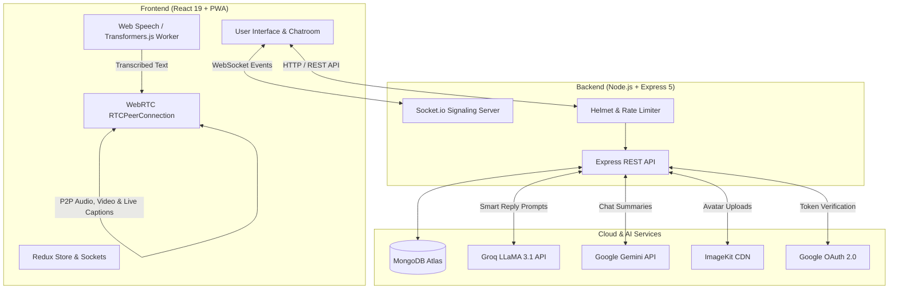

# ConnectX 💬⚡
### Next-Generation Real-Time Messaging & WebRTC Video Calling Platform with On-Device AI Captions & Generative Assistants

[](https://connectx-chat-with.netlify.app/)
[](https://react.dev/)
[](https://nodejs.org/)
[](https://socket.io/)
[](https://webrtc.org/)
[](https://web.dev/progressive-web-apps/)

---

## 🌐 Live Application
- **Working Application Link:** [https://connectx-chat-with.netlify.app/](https://connectx-chat-with.netlify.app/)

---

## 📸 Screenshots

| Mobile View - Conversations | Mobile View - Chat Room & AI |
| :---: | :---: |
|  |  |

---

## 📖 Table of Contents
- [Project Overview](#-project-overview)
- [Key Features](#-key-features)
- [How the Application Works](#-how-the-application-works)
  - [1. Authentication & Security](#1-authentication--security)
  - [2. Real-Time Chat & Unread Tracking](#2-real-time-chat--unread-tracking)
  - [3. WebRTC Audio & Video Calling](#3-webrtc-audio--video-calling)
  - [4. Real-Time On-Device Live Call Captions](#4-real-time-on-device-live-call-captions)
  - [5. Dual-Engine AI Assistance](#5-dual-engine-ai-assistance)
  - [6. Progressive Web App (PWA)](#6-progressive-web-app-pwa)
- [Technologies & Libraries Used](#-technologies--libraries-used)
- [System Architecture & Flow](#-system-architecture--flow)
- [Repository Structure](#-repository-structure)
- [API Endpoints Reference](#-api-endpoints-reference)
- [Socket.io Events Reference](#-socketio-events-reference)
- [Environment Variables](#-environment-variables)
- [Getting Started & Local Installation](#-getting-started--local-installation)

---

## 🚀 Project Overview

**ConnectX** is a modern, responsive communication platform designed to provide seamless one-on-one text chatting, crystal-clear peer-to-peer audio and video calling, and cutting-edge artificial intelligence integrations. 

Unlike traditional chat apps, ConnectX integrates **dual AI capabilities** directly into conversations:
1. **Ultra-fast Smart Reply Suggestions** via Groq Cloud (`LLaMA 3.1 8B Instant`).
2. **Contextual Chat Summaries** powered by Google Gemini (`Gemini 3 Flash Preview`).
3. **Live Closed Captions during WebRTC Video Calls**, rendered client-side using browser-native Speech Recognition with an on-device neural fallback (`@xenova/transformers` running OpenAI Whisper-Tiny in a Web Worker) streamed peer-to-peer over WebRTC DataChannels.

---

## ✨ Key Features

- 🔐 **Dual Authentication:** Traditional email/password signup and login + One-click **Google OAuth 2.0** integration.
- 💬 **Instant Real-Time Chat:** Low-latency bi-directional messaging with Socket.io and automatic read receipts (`seen` status).
- 🟢 **Live Presence & Status:** Real-time online/offline indicators and exact `lastSeen` timestamps.
- 🔔 **Global Incoming Call System:** Background incoming call ringtones, toast banners, browser notifications, and vibration feedback even when outside the chatroom.
- 📹 **Peer-to-Peer Audio & Video Calling:** Native WebRTC implementation supporting camera toggle, microphone mute, in-call timers, and dynamic video resolution switching (`360p`, `480p`, `720p`).
- 🎙️ **Live Call Captions & Transcriptions:** Real-time speech-to-text displayed over the peer's video stream, streamed directly peer-to-peer through WebRTC DataChannels.
- ⚡ **AI Smart Replies:** Context-aware 3-choice quick replies generated in milliseconds.
- 📝 **AI Conversation Summarizer:** 3-bullet executive summary of recent discussion topics, decisions made, and pending questions.
- 🖼️ **Cloud Media Storage:** User avatars uploaded and CDN-optimized through **ImageKit**.
- 📱 **Progressive Web App (PWA):** Installable on Android, iOS, and Desktop with offline caching and background service workers.
- 🛡️ **Enterprise Security:** HTTP-Only JWT cookies, Bcrypt password hashing, Helmet HTTP protection, and express-rate-limit brute force prevention.

---

## 🔍 How the Application Works

### 1. Authentication & Security
- **Registration & Login:** Users register with their name, email, password, and optional avatar image. Avatars are processed via `multer` (memory storage) and uploaded to ImageKit CDN.
- **Google OAuth 2.0:** Users can sign in with Google in a single tap via `@react-oauth/google`. The backend validates the Google access token with Google's UserInfo API, provisioning a user record or linking it automatically.
- **Sessions & JWT:** A signed JSON Web Token (valid for 2 days) is issued and set in a hardened `httpOnly`, `sameSite`, and `secure` cookie, as well as returned in payload for authorization flexibility.
- **Rate Limiting:** Authentication routes are protected with `express-rate-limit` (limiting brute force attacks to 5 attempts/hour).

### 2. Real-Time Chat & Unread Tracking
- When a user logs in, the `SocketContextProvider` establishes a persistent WebSocket connection to the backend, mapping their `userId` to their active `socket.id`.
- The user list updates in real time: as new messages arrive, the sidebar immediately updates the snippet, timestamp, and unread badge count without requiring a manual page refresh.
- When entering a chatroom, conversation history is fetched and all unread messages from the other user are marked as `seen: true`.
- Messages sent in the room are instantly dispatched to the recipient's socket and persisted in MongoDB.

### 3. WebRTC Audio & Video Calling
- **Signaling via Socket.io:** When User A initiates a call, the frontend creates an `RTCPeerConnection` with public STUN servers (`stun:stun.l.google.com:19302`), captures media streams, creates an SDP offer, and sends it through `socket.emit("callUser")`.
- **Global Call Handler:** If User B is browsing elsewhere on the platform, a persistent `GlobalCallHandler` intercepts the `incomingCall` event, plays ringtone audio, renders a top-level alert toast, and triggers system notifications.
- **P2P Streaming:** Once accepted, an SDP answer and ICE candidates are exchanged. Audio and video tracks flow directly peer-to-peer between the browsers, bypassing the application server for minimal latency.
- **In-Call Controls:** Users can mute audio, toggle camera on/off, monitor call duration, and select between 360p, 480p, or 720p constraints.

### 4. Real-Time On-Device Live Call Captions
- During an active video call, speech is recognized in real time:
  - **Primary Engine:** Browser Native Web Speech API (`SpeechRecognition` / `webkitSpeechRecognition`).
  - **Offline/Universal Fallback Engine:** Hugging Face `@xenova/transformers` running the quantized `Xenova/whisper-tiny.en` model directly inside a background **Web Worker** (`whisper.worker.js`) via WebAssembly / ONNX Runtime.
- Transcribed text chunks are tagged with a UUID and timestamp, and sent across a dedicated WebRTC `RTCDataChannel` named `live-captions`.
- The remote client receives the caption payload and renders smooth, animated subtitles on top of the remote video stream via `CaptionOverlay`.

### 5. Dual-Engine AI Assistance
- **AI Smart Quick Replies (Groq Cloud):** Clicking the magic wand icon sends the recent conversation history to `/api/messages/suggest-replies/:id`. The backend queries Groq's high-speed inference engine running `llama-3.1-8b-instant` with strict temperature and formatting prompts, returning 3 natural, under-6-word replies rendered as clickable chips.
- **AI Chat Summarization (Google Gemini):** Clicking the floating "Summarize Recent" pill calls `/api/messages/summarize/:id`. The backend leverages `@google/generative-ai` with a waterfall fallback mechanism (`gemini-3-flash-preview` ➔ `gemini-3.1-flash-lite-preview`). It synthesizes the last 15 messages into a concise 3-bullet summary focusing strictly on decisions and open questions.

### 6. Progressive Web App (PWA)
- Powered by `vite-plugin-pwa` and Workbox, the application provides an installable native-like app experience with custom home-screen icons, standalone display mode, and service worker caching for offline asset delivery.
- Uses `@vitejs/plugin-legacy` to maintain compatibility across older mobile operating systems and browsers.

---

## 🛠️ Technologies & Libraries Used

### Frontend Architecture
| Technology / Library | Purpose |
| :--- | :--- |
| **React 19** | Modern UI library with concurrent rendering and hooks |
| **Vite (Rolldown-Vite)** | Next-gen blazing fast bundler and dev server |
| **Redux Toolkit (`@reduxjs/toolkit`, `react-redux`)** | Centralized global state management (auth state, online users) |
| **React Router v7** | Client-side routing, protected routes, and page navigation |
| **Socket.io Client** | Real-time WebSocket connection for instant chat & call signaling |
| **Native WebRTC API** | `RTCPeerConnection`, `RTCDataChannel`, and MediaStream for P2P calling |
| **@xenova/transformers** | Client-side machine learning; runs Whisper Tiny speech-to-text in Web Workers |
| **Web Speech API** | High-performance native speech recognition |
| **@react-oauth/google** | Google Identity Services OAuth 2.0 integration |
| **Sass / SCSS Modules** | Modular, maintainable styles with scoped CSS classes |
| **Lucide React** | Clean, lightweight icon suite |
| **React Hook Form** | Performant form validation for login & registration |
| **React Toastify** | Interactive toast notifications for calls and alerts |
| **Vite PWA & Workbox** | Service workers, web manifest, and offline asset caching |

### Backend Architecture
| Technology / Library | Purpose |
| :--- | :--- |
| **Node.js & Express.js (v5)** | RESTful API backend runtime and web server framework |
| **MongoDB Atlas & Mongoose (v9)** | Cloud NoSQL database with indexing for rapid chat query resolution |
| **Socket.io (v4)** | Server-side WebSocket handling, room mapping, and signaling |
| **Groq SDK (`groq-sdk`)** | LLaMA 3.1 8B instant inference for smart quick replies |
| **Google Generative AI (`@google/generative-ai`)** | Gemini Flash model integration for intelligent conversation summaries |
| **ImageKit SDK** | Cloud storage and real-time CDN delivery for user profile avatars |
| **JSON Web Token (`jsonwebtoken`)** | Cryptographically signed authentication tokens |
| **Bcrypt (`bcrypt`)** | Salted hashing for user passwords |
| **Multer (`multer`)** | Multipart/form-data handler for avatar file uploads |
| **Helmet (`helmet`)** | Sets security HTTP headers to protect against common web vulnerabilities |
| **Express Rate Limit** | IP-based request throttling against brute force and DDoS |
| **Cookie Parser & CORS** | Cookie extraction and Cross-Origin Resource Sharing control |

---

## 🏗️ System Architecture & Flow



---

## 📂 Repository Structure

```text
ConnectX_P_9/
├── README.md                      # Project documentation
├── BACKEND/                       # Server-side application
│   ├── package.json
│   ├── server.js                  # HTTP & Socket.io server entry point
│   ├── .env                       # Backend environment configuration
│   └── src/
│       ├── app.js                 # Express app initialization, middleware, rate-limiters
│       ├── db/
│       │   └── db.js              # MongoDB Atlas connection handler
│       ├── models/
│       │   ├── user.model.js      # User schema (profile, credentials, status, lastSeen)
│       │   └── message.model.js   # Message schema (sender, receiver, text, seen status)
│       ├── controller/
│       │   ├── auth.controller.js # Register, login, Google OAuth, logout
│       │   ├── user.controller.js # Participant listing with unread counts & profile edit
│       │   └── message.controller.js # Send/get messages, AI reply suggestions & summary
│       ├── routes/
│       │   ├── auth.routes.js     # /api/auth routes
│       │   ├── user.routes.js     # /api/users routes
│       │   └── message.routes.js  # /api/messages routes
│       ├── middleware/
│       │   ├── aut.middleware.js  # JWT authentication validator
│       │   └── multer.middleware.js # In-memory file upload middleware
│       └── services/
│           ├── ai.service.js      # Groq LLaMA 3.1 & Google Gemini integration
│           └── imagekit.service.js # ImageKit client configuration
│
└── FRONTEND/                      # Client-side single page application
    ├── package.json
    ├── vite.config.js             # Vite, PWA, legacy device, and header configs
    ├── index.html                 # App HTML skeleton and metadata
    ├── .env                       # Frontend environment configuration
    └── src/
        ├── App.jsx                # Splash intro loader and route host
        ├── main.jsx               # React entry point with Redux & OAuth providers
        ├── router/
        │   ├── MainRoute.jsx      # Route definitions & lazy-loaded pages
        │   └── ProtectedRoute.jsx # Route guard verifying authentication
        ├── Redux/
        │   ├── store.js           # Redux store configuration
        │   └── slices/
        │       ├── authSlice.js   # Auth actions (login, register, google, logout)
        │       └── socketSlice.js # Online users list state
        ├── context/
        │   └── SocketContext.jsx  # Socket.io connection provider & user lifecycle
        ├── hooks/
        │   ├── useTranscription.js # Speech recognition & Whisper fallback hook
        │   └── useIdleTimer.js    # UI idle timer for call overlays
        ├── workers/
        │   └── whisper.worker.js  # Web Worker executing Transformers.js Whisper-Tiny
        ├── services/
        │   └── api.js             # Axios base instance with credentials
        ├── components/
        │   ├── BottomNav/         # Floating bottom navigation bar
        │   ├── CaptionOverlay.jsx # Real-time subtitle display component
        │   └── GlobalCallHandler/ # Persistent incoming call listener and toast alert
        └── Pages/
            ├── welcome/           # Onboarding splash page
            ├── Login/             # User sign-in with Google & email
            ├── Register/          # User sign-up with avatar preview
            ├── UserList/          # Conversations list, search, presence & unread badges
            ├── ProfileUpdate/     # Profile avatar & info modification
            ├── Party/             # Watch party & room features
            └── ChatRoom/          # 1-on-1 Chatroom with AI tools, Voice & Video Call
```

---

## 📡 API Endpoints Reference

### Authentication (`/api/auth`)
| Method | Endpoint | Description | Rate Limited |
| :--- | :--- | :--- | :---: |
| `POST` | `/api/auth/register` | Register new user with optional avatar image | Yes (5/hr) |
| `POST` | `/api/auth/login` | Login with email and password | Yes (5/hr) |
| `POST` | `/api/auth/google` | Sign in or sign up with Google OAuth access token | Yes (5/hr) |
| `POST` | `/api/auth/logout` | Clears authentication cookie | No |

### Users (`/api/users`)
| Method | Endpoint | Description | Auth Required |
| :--- | :--- | :--- | :---: |
| `GET` | `/api/users/participants` | Fetch all chat contacts with unread counts & last message snippet | Yes |
| `PUT` | `/api/users/update-profile` | Update profile avatar (ImageKit upload) | Yes |

### Messages & AI (`/api/messages`)
| Method | Endpoint | Description | Auth Required |
| :--- | :--- | :--- | :---: |
| `GET` | `/api/messages/:id` | Get full chat history with a user and mark incoming messages as seen | Yes |
| `POST` | `/api/messages/send/:id` | Send a new message to a user (broadcasts via Socket.io) | Yes |
| `GET` | `/api/messages/suggest-replies/:id` | Generate 3 contextual quick replies using Groq LLaMA 3.1 | Yes |
| `GET` | `/api/messages/summarize/:id` | Generate a 3-bullet conversation summary using Google Gemini | Yes |

---

## ⚡ Socket.io Events Reference

| Event Name | Direction | Payload | Description |
| :--- | :--- | :--- | :--- |
| `connection` | Client ➔ Server | `query: { userId }` | Registers user's active socket ID and marks user as online |
| `getOnlineUsers` | Server ➔ Client | `string[]` (userIds) | Emitted whenever a user connects or disconnects |
| `newMessage` | Server ➔ Client | `Message` object | Delivers newly created message in real time |
| `callUser` | Client ➔ Server | `{ userToCall, signalData, from, name, callType }` | Initiates WebRTC call request |
| `incomingCall` | Server ➔ Client | `{ signal, from, name, callType }` | Alerts the callee of an incoming call |
| `answerCall` | Client ➔ Server | `{ signal, to }` | Callee sends back SDP answer |
| `callAccepted` | Server ➔ Client | `signalData` | Caller receives accepted SDP answer |
| `sendIceCandidate` | Client ➔ Server | `{ to, candidate }` | Forwards candidate to peer |
| `receiveIceCandidate` | Server ➔ Client | `candidate` | Receives peer's ICE candidate |
| `endCall` | Client ➔ Server | `{ to }` | Notifies peer that call has terminated |
| `callEnded` | Server ➔ Client | - | Triggers stream cleanup and resets UI state |

---

## 🔑 Environment Variables

### Backend (`BACKEND/.env`)
```env
PORT=3000
MONGO_URI=your_mongodb_connection_string
JWT_SECRET=your_jwt_secret_key
CORS_ORIGIN=http://localhost:5173

# Cloud Image Storage (ImageKit)
IMAGEKIT_PUBLIC_KEY=your_imagekit_public_key
IMAGEKIT_PRIVATE_KEY=your_imagekit_private_key
IMAGEKIT_URL_ENDPOINT=your_imagekit_url_endpoint

# AI Services
GROQ_API_KEY=your_groq_api_key
GEMINI_API_KEY=your_gemini_api_key
```

### Frontend (`FRONTEND/.env`)
```env
VITE_API_URL=http://localhost:3000/api
VITE_GOOGLE_CLIENT_ID=your_google_oauth_client_id.apps.googleusercontent.com
VITE_GOOGLE_CIENT_SECRET=your_google_oauth_client_secret
```

---

## 💻 Getting Started & Local Installation

### Prerequisites
- [Node.js](https://nodejs.org/) (v18 or higher recommended)
- [MongoDB Atlas](https://www.mongodb.com/atlas) cluster or local MongoDB instance
- [ImageKit](https://imagekit.io/) account for image storage
- [Groq Cloud](https://console.groq.com/) API key for smart replies
- [Google AI Studio](https://aistudio.google.com/) API key for Gemini summaries
- [Google Cloud Console](https://console.cloud.google.com/) OAuth 2.0 Client ID

### 1. Clone the Repository
```bash
git clone https://github.com/sudhanshu9199/chat-APP-Like.git
cd ConnectX_P_9
```

### 2. Backend Setup
```bash
cd BACKEND
npm install
```
- Create a `.env` file in `BACKEND/` using the template provided above.
- Start the backend server:
```bash
npm start
# Server will run on port 3000 (or specified PORT)
```

### 3. Frontend Setup
```bash
cd ../FRONTEND
npm install
```
- Create a `.env` file in `FRONTEND/` using the template provided above.
- Start the Vite development server:
```bash
npm run dev
# App will run on http://localhost:5173
```

### 4. Build for Production
```bash
# In the FRONTEND directory
npm run build
```

---

## 👨‍💻 Author & Contributions
Developed with ❤️ by **Sudhanshu Kumar** ([@sudhanshu9199](https://github.com/sudhanshu9199)).  
Contributions, feedback, and star ratings are welcome!
