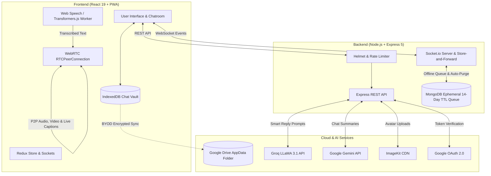

# ConnectX 💬⚡

### Next-Generation Real-Time Messaging & WebRTC Video Calling Platform with Zero-Database Architecture, On-Device AI Captions & Bring-Your-Own-Drive (BYOD) Cloud Backup

[](https://connectx-chat-with.netlify.app/)
[](https://react.dev/)
[](https://nodejs.org/)
[](https://socket.io/)
[](https://webrtc.org/)
[](https://developer.mozilla.org/en-US/docs/Web/API/IndexedDB_API)
[](https://web.dev/progressive-web-apps/)

---

## 🌐 Live Application & Compliance Links

- **Production Web Application:** [https://connectx-chat-with.netlify.app/](https://connectx-chat-with.netlify.app/)
- **Privacy Policy:** [https://connectx-chat-with.netlify.app/privacy](https://connectx-chat-with.netlify.app/privacy) *(Static fallback: `/privacy.html`)*
- **Terms of Service:** [https://connectx-chat-with.netlify.app/terms](https://connectx-chat-with.netlify.app/terms) *(Static fallback: `/terms.html`)*

---

## 📸 Screenshots

| Mobile View - Conversations | Mobile View - Chat Room & AI |
| :---: | :---: |
|  |  |

---

## 📖 Table of Contents

- [Project Overview](#-project-overview)
- [Key Features](#-key-features)
- [How the Application Works](#-how-the-application-works)
  - [1. Authentication & Google Identity](#1-authentication--google-identity)
  - [2. The ₹0 Forever "WhatsApp Post Office" Architecture](#2-the-0-forever-whatsapp-post-office-architecture)
  - [3. WebRTC Audio & Video Calling](#3-webrtc-audio--video-calling)
  - [4. Real-Time On-Device Live Call Captions](#4-real-time-on-device-live-call-captions)
  - [5. Dual-Engine AI Assistance](#5-dual-engine-ai-assistance)
  - [6. Party Mode & Live Co-Experience](#6-party-mode--live-co-experience)
  - [7. Privacy, Legal & Google Cloud Verification](#7-privacy-legal--google-cloud-verification)
- [Technologies & Libraries Used](#-technologies--libraries-used)
- [Cloud Media Storage & Free Alternatives (2026)](#-cloud-media-storage--free-alternatives-2026)
- [System Architecture & Flow](#-system-architecture--flow)
- [Repository Structure](#-repository-structure)
- [API Endpoints Reference](#-api-endpoints-reference)
- [Socket.io Events Reference](#-socketio-events-reference)
- [Environment Variables](#-environment-variables)
- [Getting Started & Local Installation](#-getting-started--local-installation)
- [Author & Support Contacts](#-author--support-contacts)

---

## 🚀 Project Overview

**ConnectX** is a cutting-edge real-time communication platform engineered with a **zero-database cost paradigm**. Built around modern WebRTC mesh networks and high-performance WebSockets, ConnectX treats the central backend server strictly as a transient post office:

1. **Zero-Database Permanent Storage:** Messages delivered to online peers stream directly peer-to-screen and are **never saved on central database servers** (0 bytes permanent MongoDB footprint).
2. **On-Device Encrypted Vault:** Full chat history, media snippets, and conversation metadata reside in the user's private browser **IndexedDB Vault** with storage eviction mitigation.
3. **Bring Your Own Drive (BYOD) Backup:** Users maintain full data sovereignty by syncing encrypted chat vault archives to their private **Google Drive AppData folder** (`drive.appdata` scope) or downloading standalone `.json` backups.
4. **Crystal HD WebRTC Calling with On-Device AI Captions:** Sub-50ms peer-to-peer audio/video streaming featuring real-time closed captions via browser-native Web Speech API and an on-device neural fallback (`@xenova/transformers` running Whisper-Tiny in a Web Worker).
5. **Dual-Engine AI Intelligence:** Context-aware quick reply chips powered by Groq (`LLaMA 3.1 8B Instant`) and multi-message conversation summarization powered by Google Gemini (`Gemini 3 Flash Preview`).

---

## ✨ Key Features

- 🛡️ **₹0 Store-and-Forward Post Office Engine:** Online messages stream live with zero cloud database writes. Offline messages are temporarily staged with a 14-day auto-purge TTL index and immediately deleted upon receipt.
- 💾 **Client-Side IndexedDB Vault (`chatDb.js`):** High-speed native IndexedDB stores messages, conversations, and metadata. Protected from OS cleanup via `navigator.storage.persist()`.
- ☁️ **Bring-Your-Own-Drive (BYOD) Cloud Backup:** User-controlled Google Drive AppData sync and 1-click JSON vault import/export.
- 🔐 **Dual Authentication:** Email/password credentials + One-click **Google OAuth 2.0** login.
- 🟢 **Live Presence & Read Receipts:** Instant online/offline statuses, `lastSeen` timestamps, and real-time `seen` acknowledgments.
- 📹 **Peer-to-Peer Audio & Video Calling:** Native WebRTC with camera toggle, microphone mute, in-call timers, and dynamic resolution selection (`360p`, `480p`, `720p`).
- 🎙️ **Live Call Captions & Transcriptions:** Real-time speech-to-text displayed over the peer's video stream, streamed directly peer-to-peer via WebRTC `RTCDataChannel`.
- ⚡ **AI Smart Replies & Summaries:** Groq LLaMA 3.1 8B instant suggestions and Gemini 3 Flash executive summaries supplied with client-side conversation context.
- 🎉 **Party Mode & Live Co-Experience:** Ephemeral synchronized watch parties supporting YouTube streams and local video playback with drop-in P2P voice channels.
- 🐾 **Stateful Living UI Companion ("Neko-Byte"):** Interactive micro-mascot with root-motion kinematics, dynamic pupil tracking, and reactive behaviors tied to active events.
- 📱 **Progressive Web App (PWA):** Installable on Android, iOS, and Desktop with offline caching and background service workers.
- 🛡️ **Enterprise Security:** HTTP-Only JWT cookies, Bcrypt password hashing, Helmet HTTP headers (`same-origin-allow-popups`), and rate-limited brute force protection.

---

## 🔍 How the Application Works

### 1. Authentication & Google Identity

- **Email & Password Authentication:** Users register with credentials and an optional avatar image. Avatars are processed via `multer` in-memory and stored on ImageKit CDN.
- **Google OAuth 2.0 Integration:** Authenticates users in a single tap via `@react-oauth/google`. The backend validates the Google access token with Google's UserInfo API, automatically provisioning or linking user profiles.
- **Session Hardening:** Signed JWT tokens (valid for 2 days) are stored in `httpOnly`, `sameSite`, and `secure` cookies, accompanied by an `express-rate-limit` guard (5 attempts/hour).

### 2. The ₹0 Forever "WhatsApp Post Office" Architecture

ConnectX eliminates ongoing cloud database hosting expenses by decentralizing chat storage:

```
[ User A ] ───(Socket.io message)───▶ [ ConnectX Server ]
                                             │
                       ┌─────────────────────┴─────────────────────┐
                       ▼                                           ▼
             [ User B is ONLINE ]                        [ User B is OFFLINE ]
                       │                                           │
         Direct peer-to-screen push                      Temporary MongoDB Queue
         (0 bytes written to MongoDB)                    (delivered: false, 14-day TTL)
                       │                                           │
         Committed to User B's Vault                     User B connects ➔ sync:pending
                       │                                           │
         msg:ack ➔ Server confirms delivery              sync:ack ➔ Server PURGES record
```

- **Zero-Database Online Transmission:** When the recipient is online, the server streams the message straight to the recipient's screen through active WebSocket connection (`socket.service.js`). The server writes **0 bytes to MongoDB**.
- **Ephemeral Offline Queue (Store-and-Forward):** If the recipient is offline, the message is temporarily staged in MongoDB with `delivered: false` and a **14-day TTL auto-purge index** (`expireAt`). As soon as the recipient opens the app or reconnects, the server pushes the waiting batch via `sync:pending`, the client commits them to local storage, sends a `sync:ack` receipt, and the server **immediately purges them from MongoDB**.
- **Client-Side IndexedDB Vault (`chatDb.js`):** Messages and conversation metadata reside securely in the user's browser device (`connectx_chat_vault`). Queries execute with 0ms network latency.
- **Storage Eviction Protection:** Calls `navigator.storage.persist()` on client boot to prevent mobile operating systems from clearing browser IndexedDB data under storage pressure.
- **Bring Your Own Drive (BYOD) Cloud Backup (`googleDriveBackup.js`):** Users can back up and restore their entire encrypted chat vault to their personal **Google Drive hidden AppData folder** (`drive.appdata` scope) or export an offline `.json` vault backup file in one click.
- **AI Context Preservation:** When calling Groq Quick Replies or Gemini Chat Summarizer, the frontend supplies the recent message context from local IndexedDB in `req.body.messages`, preserving AI intelligence without keeping server-side logs.

### 3. WebRTC Audio & Video Calling

- **Signaling via Socket.io:** Initiates calls via `socket.emit("callUser")` with SDP offers and candidate exchange over public Google STUN servers (`stun:stun.l.google.com:19302`).
- **Global Call Alert:** If the recipient is browsing another page, `GlobalCallHandler` intercepts `incomingCall`, plays custom ringtones, displays an interactive toast banner, and triggers browser notifications.
- **Direct P2P Media Streams:** Once accepted, media streams flow peer-to-peer between client browsers without touching the server, ensuring optimal bandwidth and privacy.

### 4. Real-Time On-Device Live Call Captions

- **Primary Engine:** Browser-native Web Speech API (`SpeechRecognition` / `webkitSpeechRecognition`).
- **Offline/Universal Neural Fallback:** Hugging Face `@xenova/transformers` executing the quantized `Xenova/whisper-tiny.en` model directly inside a dedicated **Web Worker** (`whisper.worker.js`) via WebAssembly / ONNX Runtime.
- **DataChannel Distribution:** Transcribed text chunks are sent across an `RTCDataChannel` named `live-captions` and rendered as animated subtitles over the remote video frame via `CaptionOverlay`.

### 5. Dual-Engine AI Assistance

- **Groq LLaMA 3.1 8B Instant Suggestions:** Submits recent conversation context to `/api/messages/suggest-replies/:id`. Groq generates 3 natural quick-reply options returned in milliseconds.
- **Google Gemini Chat Summaries:** Submits recent conversation context to `/api/messages/summarize/:id`. Google Gemini (`gemini-3-flash-preview` with waterfall fallback to `gemini-3.1-flash-lite-preview`) generates a 3-bullet executive summary covering key topics, decisions, and open items.

### 6. Party Mode & Live Co-Experience

- **Synchronized Watch Parties:** Ephemeral rooms supporting synchronized YouTube playback and local media file streaming.
- **P2P Audio Lounge:** Drop-in voice chat mesh with live audio meters and reactive speaking rings.
- **Interactive Reactions:** Floating glassmorphic emoji bursts and live participant presence.

### 7. Privacy, Legal & Google Cloud Verification

ConnectX meets Google Cloud OAuth verification standards:
- **Public 2026 Landing Page:** The home route (`/`) provides full public product disclosures, feature architecture explanations, and footer links without being behind a login wall.
- **Dedicated Legal Pages:** Fully styled, responsive [Privacy Policy](/privacy) and [Terms of Service](/terms) with static HTML fallbacks (`public/privacy.html`, `public/terms.html`) for search engine and verification bots.
- **Google API Scopes Disclosure:** Transparently documents Google Sign-In and Google Drive AppData (`drive.appdata`) scope usage. Chat backups remain strictly inside the user's private application data folder and are never inspected or sold.

---

## 🛠️ Technologies & Libraries Used

### Frontend Architecture

| Technology / Library | Purpose |
| :--- | :--- |
| **React 19** | Concurrent UI rendering with hooks and lazy-loading |
| **Vite (Rolldown-Vite)** | Next-generation bundler and development server |
| **IndexedDB API (`chatDb.js`)** | Client-side native high-performance message storage vault |
| **Google Drive REST API v3** | Bring-Your-Own-Drive (BYOD) cloud backup via `drive.appdata` |
| **Redux Toolkit (`@reduxjs/toolkit`)** | Centralized auth and presence state management |
| **React Router v7** | Client routing with `RouteErrorBoundary` and lazy routes |
| **Socket.io Client** | Real-time bi-directional messaging and call signaling |
| **Native WebRTC API** | Direct peer-to-peer audio, video, and DataChannel streaming |
| **@xenova/transformers** | Client-side Whisper-Tiny speech-to-text running in Web Workers |
| **Web Speech API** | Native speech recognition engine |
| **@react-oauth/google** | Google Identity Services OAuth 2.0 integration |
| **Sass / SCSS Modules** | Scoped modular styling with 2026 cyber glassmorphism |
| **Lucide React** | Clean, lightweight modern icons |
| **React Hook Form** | Performant form validation |
| **React Toastify** | Interactive toast notifications for calls and alerts |
| **Vite PWA & Workbox** | Service workers, web manifest, and offline caching |

### Backend Architecture

| Technology / Library | Purpose |
| :--- | :--- |
| **Node.js & Express.js (v5)** | RESTful API backend runtime and web server framework |
| **MongoDB Atlas & Mongoose (v9)** | Cloud database with TTL auto-purge indexing for offline queue |
| **Socket.io (v4)** | Server-side WebSocket handling, rooms, and signaling |
| **Groq SDK (`groq-sdk`)** | LLaMA 3.1 8B instant inference for smart replies |
| **Google Generative AI (`@google/generative-ai`)** | Gemini Flash model integration for chat summaries |
| **ImageKit SDK** | Cloud storage and CDN optimization for profile avatars |
| **JSON Web Token (`jsonwebtoken`)** | Signed session authentication tokens |
| **Bcrypt (`bcrypt`)** | Password hashing with cryptographic salts |
| **Multer (`multer`)** | In-memory multipart/form-data handler for uploads |
| **Helmet (`helmet`)** | HTTP security headers with `same-origin-allow-popups` COOP |
| **Express Rate Limit** | Request rate limiting against brute force attempts |

---

## ☁️ Cloud Media Storage & Free Alternatives (2026)

ConnectX uses **ImageKit** for real-time asset delivery and avatar transformations. For deployments seeking **100% free / ₹0-cost** media hosting in 2026, the best drop-in alternatives are:

| Provider | Free Tier Allowance | Key Highlights | Best For |
| :--- | :--- | :--- | :--- |
| **Cloudflare R2 + CDN** *(Recommended)* | **10 GB Storage**, **$0 Egress** (Unlimited Bandwidth) | Zero egress fees, global edge CDN caching, S3-compatible API | High-traffic video & static media hosting |
| **Cloudinary** | 25 Credits/mo (~25 GB Bandwidth or Storage) | Automatic transformations (`f_auto`, `q_auto`), direct ImageKit rival | Dynamic image & video transformations |
| **Supabase Storage** | 1 GB Storage, 5 GB/mo Bandwidth | Built on S3 with global CDN caching, native Postgres RLS | Full-stack apps with unified database & auth |
| **Firebase Storage** | 5 GB Storage, 1 GB/day Bandwidth | Google Cloud infrastructure with battle-tested client SDKs | Fast mobile-first prototyping |

---

## 🏗️ System Architecture & Flow



---

## 📂 Repository Structure

```text
ConnectX_P_9/
├── README.md                      # Comprehensive project documentation
├── BACKEND/                       # Server-side application
│   ├── package.json
│   ├── server.js                  # Socket.io server, sync:pending, sync:ack, msg:ack
│   ├── .env                       # Backend environment configuration
│   └── src/
│       ├── app.js                 # Express app, Helmet COOP headers, rate-limiters
│       ├── db/
│       │   └── db.js              # MongoDB Atlas connection handler
│       ├── models/
│       │   ├── user.model.js      # User schema (profile, status, lastSeen)
│       │   └── message.model.js   # Ephemeral schema with 14-day auto-purge TTL
│       ├── controller/
│       │   ├── auth.controller.js # Register, login, Google OAuth, logout
│       │   ├── user.controller.js # Participant directory with unread counts
│       │   └── message.controller.js # Instant purge on delivery, AI context handlers
│       ├── routes/
│       │   ├── auth.routes.js     # /api/auth routes
│       │   ├── user.routes.js     # /api/users routes
│       │   └── message.routes.js  # /api/messages routes
│       ├── middleware/
│       │   ├── aut.middleware.js  # JWT authentication validator
│       │   └── multer.middleware.js # In-memory file upload middleware
│       └── services/
│           ├── ai.service.js      # Groq LLaMA 3.1 & Google Gemini integration
│           └── imagekit.service.js # ImageKit client configuration
│
└── FRONTEND/                      # Client-side single page application
    ├── package.json
    ├── vite.config.js             # Vite, PWA, legacy device, and header configs
    ├── index.html                 # Google site verification & font preconnects
    ├── .env                       # Frontend environment configuration
    ├── public/
    │   ├── privacy.html           # Standalone static Privacy Policy fallback
    │   ├── terms.html             # Standalone static Terms of Service fallback
    │   ├── _redirects             # Netlify SPA redirect rules
    │   └── icons/                 # High-res brand icons (512x512, 384x384, 192x192)
    └── src/
        ├── App.jsx                # Splash intro loader with instant legal bypass
        ├── main.jsx               # React entry point with Redux & OAuth providers
        ├── router/
        │   ├── MainRoute.jsx      # Static legal routes & RouteErrorBoundary
        │   └── ProtectedRoute.jsx # Route guard verifying authentication
        ├── Redux/
        │   ├── store.js           # Redux store configuration
        │   └── slices/
        │       ├── authSlice.js   # Auth actions (login, register, google, logout)
        │       └── socketSlice.js # Online users list state
        ├── context/
        │   └── SocketContext.jsx  # Socket lifecycle, sync:ack & msg:ack handlers
        ├── services/
        │   ├── api.js             # Axios base instance with credentials
        │   ├── chatDb.js          # Native IndexedDB Vault (connectx_chat_vault)
        │   └── googleDriveBackup.js # Google Drive AppData sync & JSON vault export
        ├── components/
        │   ├── BrandLogo/         # 2026 Brand Logo with cyber squircle & styled text
        │   ├── BottomNav/         # Floating bottom navigation bar
        │   ├── CaptionOverlay.jsx # Real-time subtitle display component
        │   └── GlobalCallHandler/ # Persistent incoming call listener and alert toast
        └── Pages/
            ├── welcome/           # 2026 Public Landing page & Google compliance showcase
            ├── Login/             # Sign-in with BrandLogo & Google OAuth
            ├── Register/          # Sign-up with BrandLogo & avatar preview
            ├── UserList/          # Conversations list merged with local IndexedDB
            ├── ProfileUpdate/     # Profile settings, eviction status & Chat Vault controls
            ├── Party/             # Synchronized watch parties & P2P voice lounges
            ├── Legal/             # In-app Privacy Policy & Terms of Service
            └── ChatRoom/          # 1-on-1 Chatroom with 0ms IndexedDB rendering & AI tools
```

---

## 📡 API Endpoints Reference

### Authentication (`/api/auth`)

| Method | Endpoint | Description | Rate Limited |
| :--- | :--- | :--- | :---: |
| `POST` | `/api/auth/register` | Register new user with optional avatar image | Yes (5/hr) |
| `POST` | `/api/auth/login` | Login with email and password | Yes (5/hr) |
| `POST` | `/api/auth/google` | Sign in or sign up with Google OAuth access token | Yes (5/hr) |
| `POST` | `/api/auth/logout` | Clears authentication cookie | No |

### Users (`/api/users`)

| Method | Endpoint | Description | Auth Required |
| :--- | :--- | :--- | :---: |
| `GET` | `/api/users/participants` | Fetch all chat contacts with unread counts & last message snippet | Yes |
| `PUT` | `/api/users/update-profile` | Update profile avatar (ImageKit upload) | Yes |

### Messages & AI (`/api/messages`)

| Method | Endpoint | Description | Auth Required |
| :--- | :--- | :--- | :---: |
| `GET` | `/api/messages/:id` | Fetch offline pending messages and purge from DB upon receipt | Yes |
| `POST` | `/api/messages/send/:id` | Send message (delivered instantly peer-to-screen if online) | Yes |
| `GET` / `POST` | `/api/messages/suggest-replies/:id` | Generate 3 contextual quick replies using Groq LLaMA 3.1 | Yes |
| `GET` / `POST` | `/api/messages/summarize/:id` | Generate a 3-bullet conversation summary using Google Gemini | Yes |

---

## ⚡ Socket.io Events Reference

| Event Name | Direction | Payload | Description |
| :--- | :--- | :--- | :--- |
| `connection` | Client ➔ Server | `query: { userId }` | Registers active socket ID and pushes any pending offline messages |
| `sync:pending` | Server ➔ Client | `Message[]` | Pushes offline messages waiting in the temporary queue |
| `sync:ack` | Client ➔ Server | `string[]` (messageIds) | Acknowledges batch commit into IndexedDB; server deletes records |
| `newMessage` | Server ➔ Client | `Message` object | Delivers message in real time to the online recipient |
| `msg:ack` | Client ➔ Server | `{ messageId, from }` | Confirms receipt of real-time message |
| `getOnlineUsers` | Server ➔ Client | `string[]` (userIds) | Emitted whenever a user connects or disconnects |
| `callUser` | Client ➔ Server | `{ userToCall, signalData, from, name, callType }` | Initiates WebRTC call request |
| `incomingCall` | Server ➔ Client | `{ signal, from, name, callType }` | Alerts the callee of an incoming call |
| `answerCall` | Client ➔ Server | `{ signal, to }` | Callee sends back SDP answer |
| `callAccepted` | Server ➔ Client | `signalData` | Caller receives accepted SDP answer |
| `sendIceCandidate` | Client ➔ Server | `{ to, candidate }` | Forwards ICE candidate to peer |
| `receiveIceCandidate` | Server ➔ Client | `candidate` | Receives peer's ICE candidate |
| `endCall` | Client ➔ Server | `{ to }` | Notifies peer that call has terminated |
| `callEnded` | Server ➔ Client | - | Triggers stream cleanup and resets UI state |

---

## 🔑 Environment Variables

### Backend (`BACKEND/.env`)

```env
PORT=3000
MONGO_URI=your_mongodb_connection_string
JWT_SECRET=your_jwt_secret_key
CORS_ORIGIN=http://localhost:5173

# Cloud Image Storage (ImageKit)
IMAGEKIT_PUBLIC_KEY=your_imagekit_public_key
IMAGEKIT_PRIVATE_KEY=your_imagekit_private_key
IMAGEKIT_URL_ENDPOINT=your_imagekit_url_endpoint

# AI Services
GROQ_API_KEY=your_groq_api_key
GEMINI_API_KEY=your_gemini_api_key
```

### Frontend (`FRONTEND/.env`)

```env
VITE_API_URL=http://localhost:3000/api
VITE_GOOGLE_CLIENT_ID=your_google_oauth_client_id.apps.googleusercontent.com
VITE_GOOGLE_CIENT_SECRET=your_google_oauth_client_secret
```

---

## 💻 Getting Started & Local Installation

### Prerequisites

- [Node.js](https://nodejs.org/) (v18 or higher recommended)
- [MongoDB Atlas](https://www.mongodb.com/atlas) cluster or local MongoDB instance
- [ImageKit](https://imagekit.io/) account for image storage
- [Groq Cloud](https://console.groq.com/) API key for smart replies
- [Google AI Studio](https://aistudio.google.com/) API key for Gemini summaries
- [Google Cloud Console](https://console.cloud.google.com/) OAuth 2.0 Client ID

### 1. Clone the Repository

```bash
git clone https://github.com/sudhanshu9199/chat-APP-Like.git
cd ConnectX_P_9
```

### 2. Backend Setup

```bash
cd BACKEND
npm install
```

- Create a `.env` file in `BACKEND/` using the template provided above.
- Start the backend server:

```bash
npm start
# Server runs on port 3000 (or specified PORT)
```

### 3. Frontend Setup

```bash
cd ../FRONTEND
npm install
```

- Create a `.env` file in `FRONTEND/` using the template provided above.
- Start the Vite development server:

```bash
npm run dev
# App runs on http://localhost:5173
```

### 4. Build for Production

```bash
# In the FRONTEND directory
npm run build
```

---

## 👨‍💻 Author & Support Contacts

- **Developer & Lead Maintainer:** Sudhanshu Ghosh ([@sudhanshu9199](https://github.com/sudhanshu9199))
- **Developer Contact:** [shudhanshukumar9713@gmail.com](mailto:shudhanshukumar9713@gmail.com)
- **Official App Support:** [dearsubject@gmail.com](mailto:dearsubject@gmail.com)
- **Live Deployment:** [https://connectx-chat-with.netlify.app/](https://connectx-chat-with.netlify.app/)
